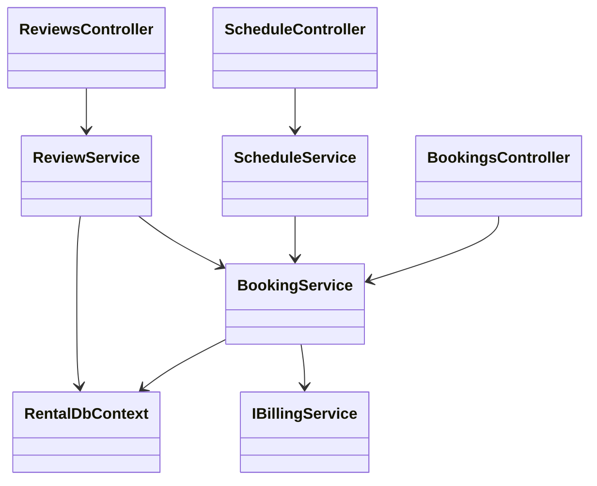
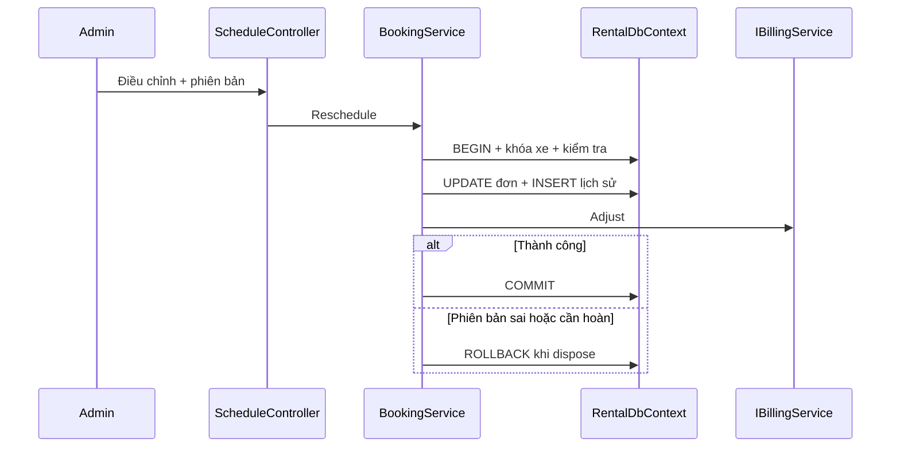

# Phần Nam – đối chiếu sơ bộ
UC3: tạo, tìm, xem, xác nhận, từ chối, hủy, giao, trả, hiển thị quá hạn. Sửa thông tin ngoài đổi lịch còn thiếu.
UC5: danh sách, lịch sử, điều chỉnh và gia hạn; cập nhật hóa đơn qua IBillingService.Adjust trong transaction chung. Chưa có lịch tuần động và chọn phụ phí.
UC10.4: ghi điểm xe/dịch vụ sau trả và lưu hướng cải thiện.

