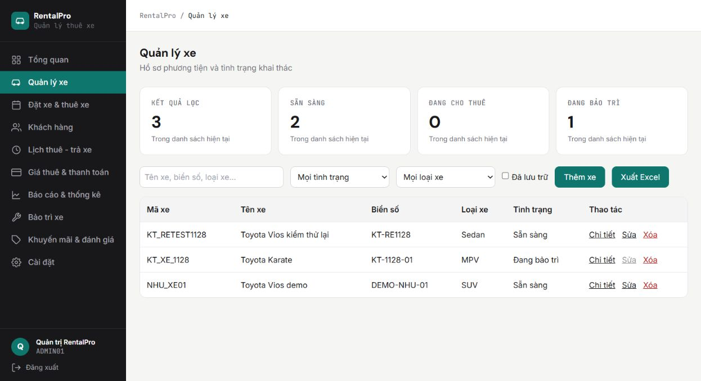
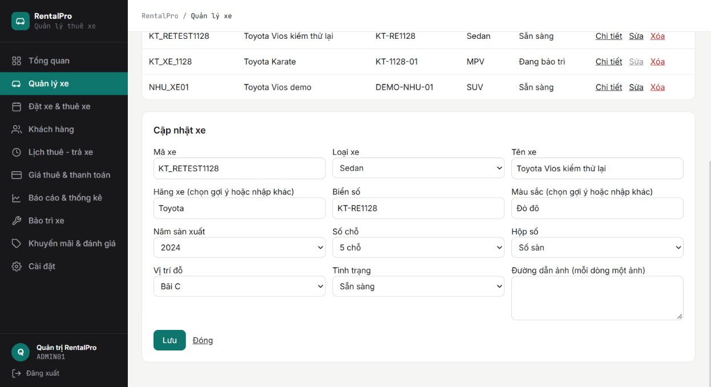
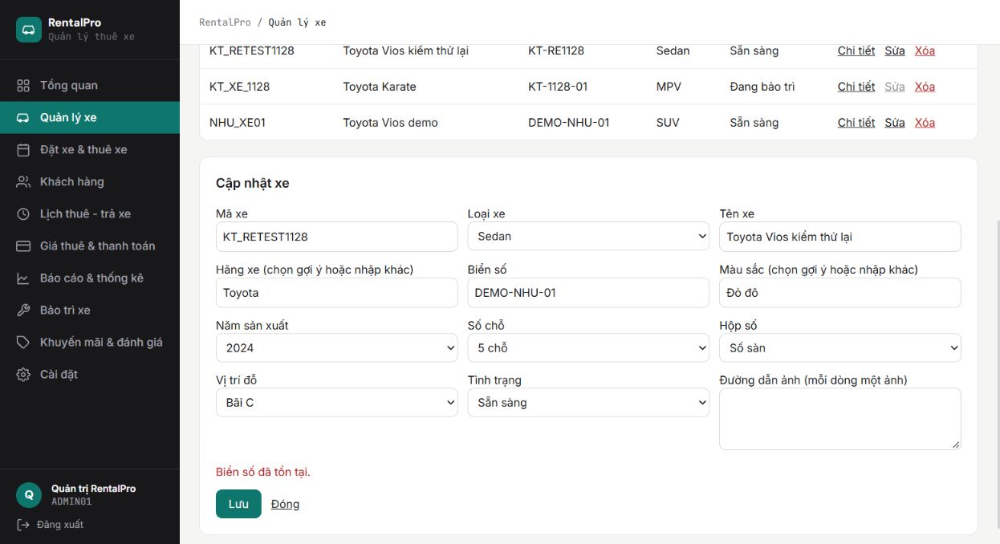
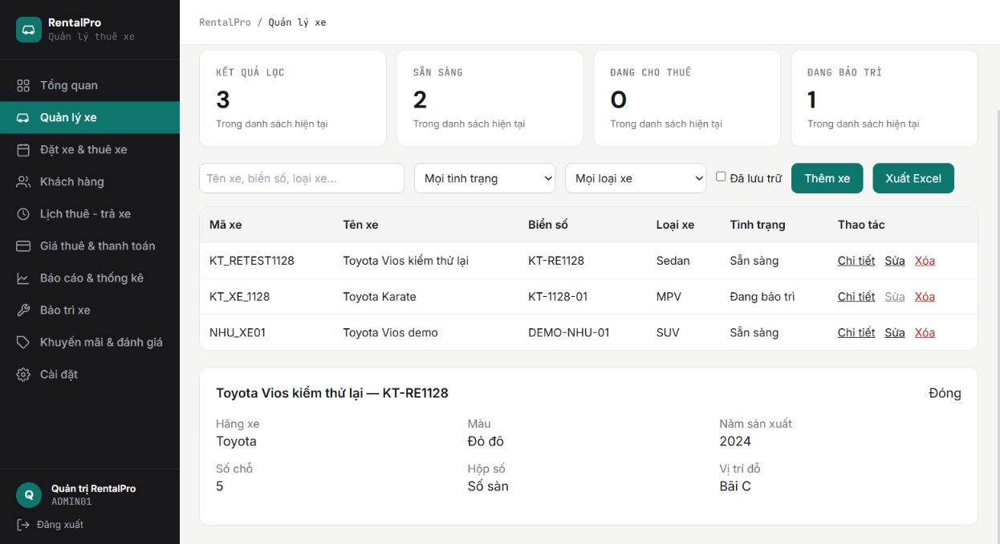
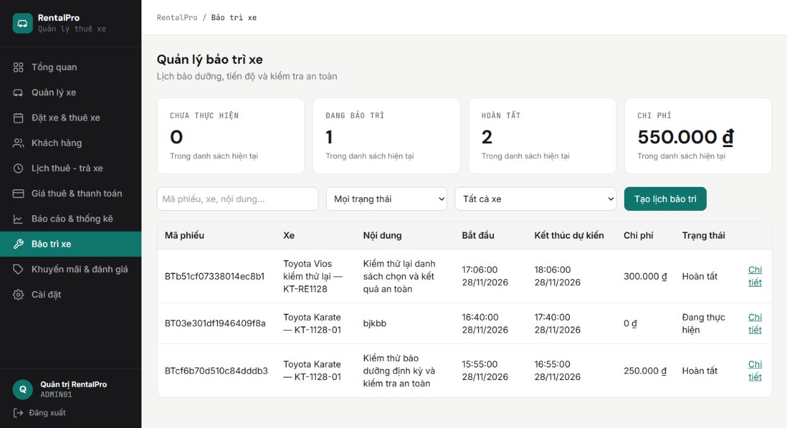
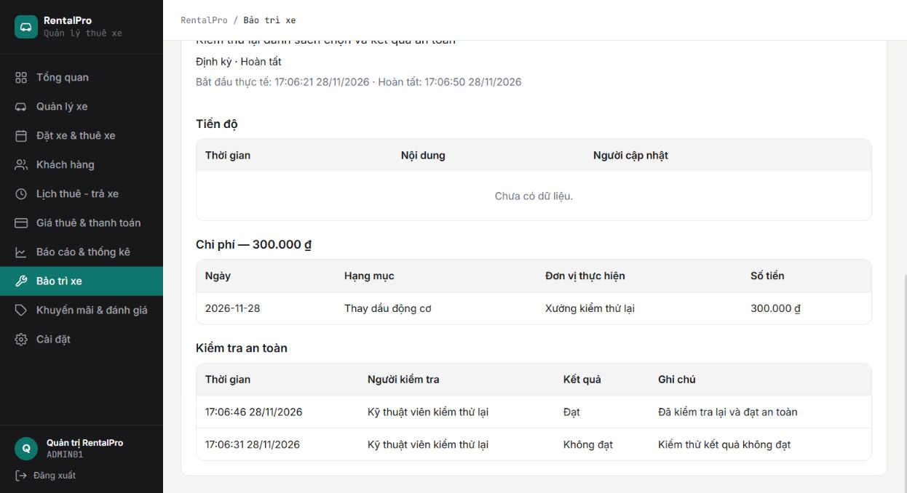
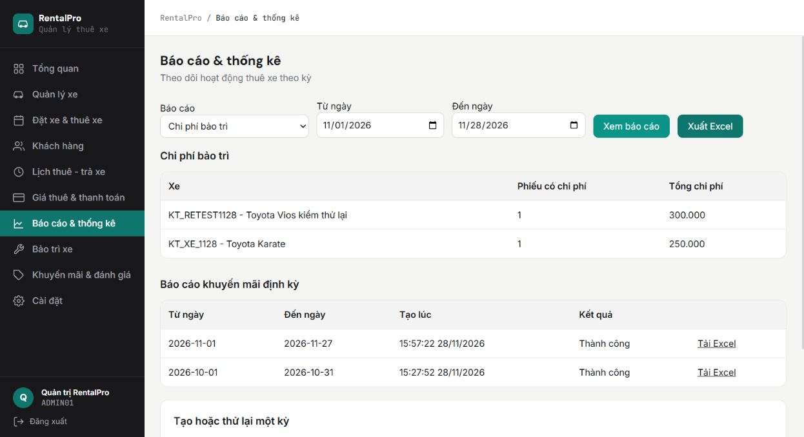
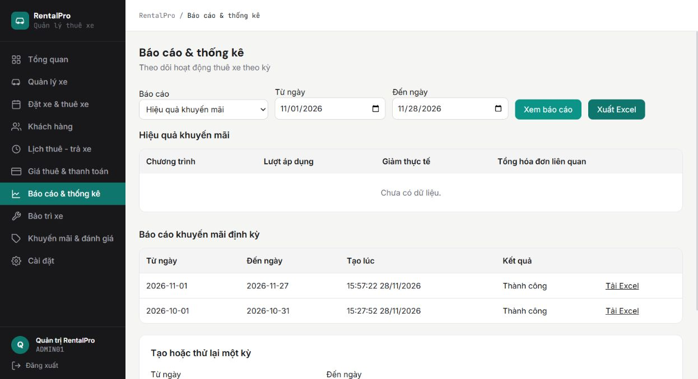

# Minh chứng kiểm thử xe bảo trì và báo cáo

Ngày kiểm thử và chụp ảnh: **28/11/2026**. Các luồng đã kiểm tra chạy được trên bản Docker hiện tại. Chi phí của phiếu bảo trì khớp với báo cáo trên web và file Excel tải xuống.

Phiên bản: commit nền `c0cf25f`, kèm thay đổi giao diện chưa commit trong `Vehicles.tsx`, `Maintenance.tsx` và `fleetApi.tsx`. Khi chốt bàn giao, cần ghi thêm mã commit chứa ba thay đổi này.

## Môi trường và dữ liệu

- Web: `http://localhost:5080`, chạy bằng Docker Compose cùng SQL Server.
- Tài khoản kiểm thử giao diện: `ADMIN01`, có quyền quản trị.
- Xe đối chiếu: `KT_RETEST1128`, biển số `KT-RE1128`, tên `Toyota Vios kiểm thử lại`.
- Hồ sơ xe: Sedan, Toyota, màu Đỏ đô, năm 2024, 5 chỗ, Số sàn, Bãi C.
- Phiếu bảo trì: `BTb51cf07338014ec8b1`, đã hoàn tất, chi phí 300.000 đồng.
- Kỳ báo cáo chi phí: 01/11/2026–28/11/2026.

Ảnh được chụp trực tiếp từ nội dung trang web, không chứa desktop, thanh tab trình duyệt hoặc công cụ điều khiển. Ảnh chụp mới thể hiện cả trạng thái dữ liệu đã lưu từ lượt kiểm thử cùng ngày và trường hợp biển số trùng được thực hiện lại khi lập bộ minh chứng này.

## Quản lý xe

### Danh sách xe

Mở Quản lý xe và kiểm tra xe `KT_RETEST1128` trong danh sách. Xe hiển thị đúng tên, biển số, loại xe và trạng thái Sẵn sàng sau khi hoàn tất bảo trì. Các xe khác được giữ nguyên.

**Kết quả: đạt.**

### Biểu mẫu và danh sách chọn

Mở Sửa tại xe kiểm thử. Mã xe được khóa. Loại xe, năm sản xuất, số chỗ, hộp số, bãi đỗ và tình trạng có danh sách chọn; hãng xe và màu sắc có gợi ý nhưng vẫn cho nhập giá trị khác. Giới hạn đang áp dụng là 2000–năm hiện tại và 4–16 chỗ.

**Kết quả: đạt.** Phần ảnh giữ nguyên theo phạm vi triển khai hiện tại.

### Chặn biển số trùng

Trong biểu mẫu sửa xe `KT_RETEST1128`, đổi biển số thành `DEMO-NHU-01`, là biển số của xe đã có, rồi bấm Lưu.

**Kết quả: đạt.** Hệ thống báo “Biển số đã tồn tại.” Thao tác bị từ chối; đóng biểu mẫu không lưu và mở lại Chi tiết vẫn thấy biển số gốc `KT-RE1128`.

### Đọc lại dữ liệu đã lưu

Trong lượt kiểm thử cùng ngày, tên xe được nhập với khoảng trắng thừa và biển số được nhập dạng ` kt- re1128 `. Sau khi lưu, tên hiển thị `Toyota Vios kiểm thử lại`, biển số thành `KT-RE1128`. Màu Đỏ đô giữ nguyên dấu tiếng Việt; hộp số Số sàn và vị trí Bãi C được đọc lại đúng.

**Kết quả: đạt.** Ảnh dưới là trạng thái đọc lại từ chức năng Chi tiết, sau lần thử biển số trùng.

## Bảo trì xe

### Lập lịch và hoàn tất phiếu

Luồng đã thực hiện trong lượt kiểm thử cùng ngày:

1. Chọn xe `KT_RETEST1128`, loại Định kỳ, thời gian dự kiến 17:06–18:06 ngày 28/11/2026 và nhập nội dung.
2. Lưu lịch, mở Chi tiết và bắt đầu bảo trì.
3. Ghi chi phí Thay dầu động cơ, đơn vị Xưởng kiểm thử lại, số tiền 300.000 đồng.
4. Thử gửi kết quả an toàn khi chưa chọn Đạt/Không đạt: trình duyệt yêu cầu chọn kết quả.
5. Chọn Không đạt và lưu: nút Hoàn tất bảo trì bị khóa.
6. Ghi lần kiểm tra mới là Đạt, sau đó hoàn tất phiếu.

**Kết quả: đạt.** Phiếu bắt đầu thực tế lúc 17:06:21, hoàn tất lúc 17:06:50. Xe trở lại trạng thái Sẵn sàng. Ảnh dưới được chụp lại từ trạng thái đã lưu; không dùng ảnh trạng thái hoàn tất để thay thế minh chứng trực tiếp của nút bị khóa.

### Chi phí và lịch sử an toàn

Mở Chi tiết phiếu đã hoàn tất. Dòng chi phí ghi đúng ngày, hạng mục, đơn vị thực hiện và 300.000 đồng. Lịch sử có lần Không đạt lúc 17:06:31 và lần Đạt mới hơn lúc 17:06:46.

**Kết quả: đạt.** Phiếu này chưa ghi tiến độ; bảng Tiến độ trống đúng với dữ liệu của phiếu. Chức năng ghi tiến độ được kiểm tra trong bộ kiểm thử tích hợp SQL Server.

## Báo cáo và xuất Excel

### Đối chiếu chi phí bảo trì

Chọn Chi phí bảo trì, kỳ 01/11/2026–28/11/2026, bấm Xem báo cáo và Xuất Excel. Kiểm tra nội dung workbook vừa tải, không chỉ kiểm tra tên tệp.

| Xe | Số phiếu có chi phí | Trên web | Trong Excel |
|---|---:|---:|---:|
| KT_RETEST1128 | 1 | 300.000 đồng | 300.000 đồng |
| KT_XE_1128 | 1 | 250.000 đồng | 250.000 đồng |

**Kết quả: đạt.** Tổng hai dòng là 550.000 đồng, khớp tổng chi phí trong danh sách bảo trì.

File tải thực tế: [Báo cáo chi phí](evidence/operations/bao-cao-chi-phi.xlsx).

### Báo cáo khuyến mãi

Chọn Hiệu quả khuyến mãi để xem dữ liệu hiện tại, sau đó tải Excel ở dòng kỳ 01/11/2026–27/11/2026 trong danh sách báo cáo định kỳ.

**Kết quả: đạt đối với hiển thị kỳ rỗng và tải đúng loại tệp.** File có bốn cột: Chương trình, Lượt áp dụng, Giảm thực tế và Tổng hóa đơn liên quan; không chứa dữ liệu danh sách xe. File định kỳ này chưa có dòng dữ liệu trong kỳ. Trạng thái Thành công là trạng thái tạo tệp.

Chưa dùng dữ liệu demo hiện tại để nghiệm thu một chương trình có lượt áp dụng thực tế và hóa đơn; cần bổ sung kịch bản liên mô-đun với phần đặt xe và thanh toán. Bộ kiểm thử SQL riêng đã có dữ liệu mẫu để đối chiếu phép tổng hợp khuyến mãi và hóa đơn.

File tải thực tế: [Báo cáo khuyến mãi](evidence/operations/bao-cao-khuyen-mai.xlsx).

## Kiểm thử tự động cùng phiên bản

Build .NET và React đã qua. Bộ `OperationsChecks`, `ModuleAccessChecks` và `OperationsIntegration` đã chạy thành công trong lượt kiểm thử trước khi chụp bộ ảnh này. Kiểm thử tích hợp dùng database thử riêng trên SQL Server và dọn database thử khi kết thúc.

| Nhóm | Các trường hợp đã qua |
|---|---|
| Nhập liệu xe | Chuẩn hóa tên/biển số; màu tiếng Việt khi tạo và sửa; từ chối biển số trùng; giới hạn năm và số chỗ; hộp số và bãi đỗ hợp lệ |
| Xóa và lưu trữ | Xóa vật lý xe chưa có lịch sử; lưu trữ xe có lịch sử; giữ dữ liệu bảo trì |
| Lịch xe | Chặn lịch thuê/bảo trì trùng; cho phép tiếp giáp; hai yêu cầu đồng thời chỉ một bên giữ lịch |
| Bảo trì | Ghi tiến độ, chi phí và an toàn; lấy kết quả an toàn mới nhất; chỉ hoàn tất khi đạt; khóa sửa phiếu hoàn tất |
| Báo cáo | Truy vấn đủ 7 loại; kỳ rỗng; biên ngày theo giờ Việt Nam; số tiền khớp dữ liệu nguồn |
| Báo cáo định kỳ | Không tạo trùng cùng kỳ khi chạy đồng thời; tải tệp; tạo lại tệp thiếu; thử lại kỳ thất bại |
| Phân quyền | Policy riêng cho Xe/Bảo trì/Báo cáo; từ chối người chưa đăng nhập hoặc chỉ có quyền của mô-đun khác |

Mã kiểm thử: [quy tắc xe](../../tests/CarRental.Tests/Fleet/OperationsChecks.cs), [phân quyền](../../tests/CarRental.Tests/Fleet/ModuleAccessChecks.cs), [tích hợp SQL](../../tests/CarRental.Tests/Scenarios/OperationsIntegration.cs).

## Phần cần bổ sung khi nghiệm thu nhóm

- Kiểm thử giao diện bằng tài khoản hạn quyền; hiện bộ ảnh dùng Admin có quyền quản trị.
- Chạy và chụp kịch bản liên mô-đun có đơn thuê, mã khuyến mãi, hóa đơn và số liệu báo cáo thực tế trên database demo.
- Kiểm tra sao lưu và phục hồi SQL Server cùng các tệp báo cáo.
- Chốt commit giao diện và nhờ một thành viên khác chạy lại.

Chưa kết luận nghiệm thu toàn bộ hệ thống từ bộ minh chứng này. Dữ liệu kiểm thử được giữ lại để đối chiếu; không có thao tác xóa dữ liệu kinh doanh trong quá trình chụp.
