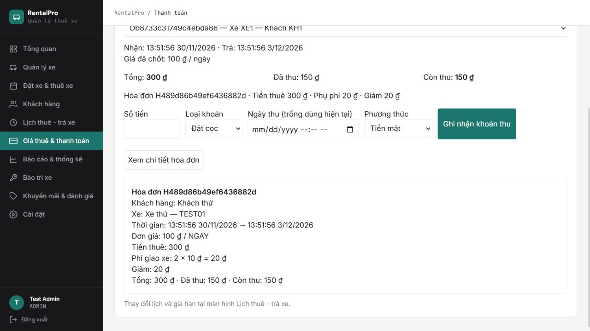
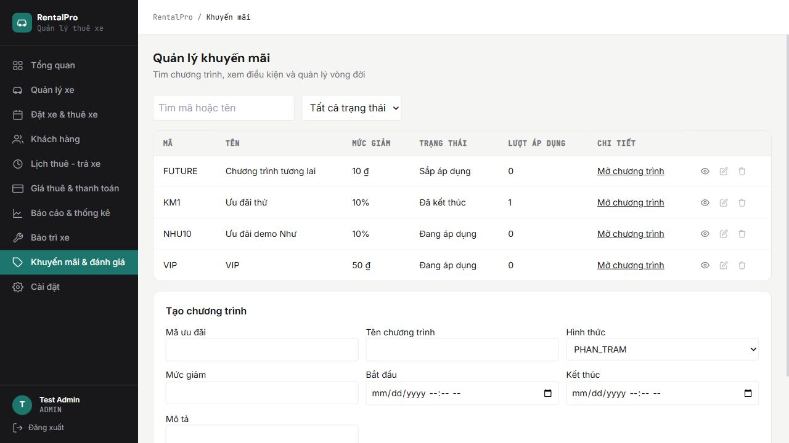
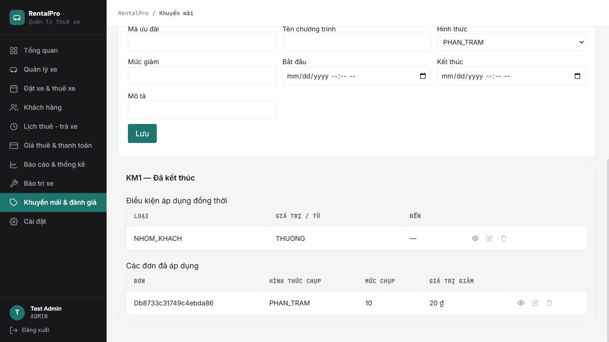

# Bàn giao phần giá thuê thanh toán và khuyến mãi

Người phụ trách Phạm Quỳnh Như. Phạm vi UC4 và UC10.1–UC10.3 gồm 18 UC chi tiết. Bản mã được kiểm tra là commit 8928480 trên main. Ngày tự kiểm tra và chụp minh chứng 28/11/2026.

Phần triển khai đã được tự kiểm tra bằng các bộ SQL/HTTP integration, operations và billing-flow. Ba ảnh dưới được chụp trực tiếp từ giao diện chạy với cơ sở dữ liệu thử; không phải ảnh dựng. Kết quả tự kiểm tra không thay thế xác nhận của thành viên duyệt độc lập.

## Nội dung bàn giao

- Mã nguồn Billing/Promotions, hợp đồng dùng chung và giao diện quản trị đã nằm trên main.
- Script SQL sở hữu bảng thuộc 04_pricing, 06_billing và 08_promotions; dữ liệu demo tại database/seeds/nhu-demo.sql.
- [Bảng đối chiếu đủ 18 UC và kịch bản demo](nhu-acceptance.md).
- [Cách chạy và hợp đồng ghép mô-đun](billing-promotions.md).
- [Kết quả chạy web và SQL Server bằng Docker](nhu-docker-result.md), kèm scripts/Test-NhuDocker.ps1 để chạy lại.

## Kết quả tự kiểm tra

Đã thực thi thành công:

```powershell
$env:CARRENTAL_TEST_MASTER='Server=(localdb)\MSSQLLocalDB;Database=master;Integrated Security=True;TrustServerCertificate=True'
dotnet run --project tests/CarRental.Tests --no-restore -- integration operations billing-flow preview
```

Bộ integration kiểm tra giá và giảm chụp, thu vượt, hai khoản thu đồng thời, gửi lại giao dịch, phiên bản hóa đơn, khoản cần hoàn và hoàn tác lịch cùng hóa đơn. Bộ operations kiểm tra điểm ghép Fleet/Maintenance/Reports. Bộ billing-flow dùng đủ 10 nhóm script, khởi động máy chủ HTTP riêng và kiểm tra đăng nhập, CSRF, nhóm khách thật, tạo đơn kèm ưu đãi, cọc trước hóa đơn, xem trước, lập hóa đơn, gia hạn, phụ phí đã ngừng, phản ánh, vòng đời chương trình, quyền cá nhân và thu hồi phiên.

Chế độ preview chỉ giữ máy chủ thử để quan sát giao diện. Sau khi lấy ảnh, đã kết thúc preview; máy chủ dừng và cơ sở dữ liệu thử được xóa theo finally của bộ kiểm thử. Không sử dụng mật khẩu thử để triển khai hoặc đưa vào báo cáo.

Bản Docker cũng đã được kiểm tra trước đó, có bằng chứng riêng tại nhu-docker-result.md. Docker và LocalDB là hai lần thực thi khác nhau; ảnh dưới thuộc lần LocalDB ngày 28/11/2026.

## Ảnh minh chứng

### Chi tiết hóa đơn và đối soát tiền



UC4.4, UC4.5. Bộ dữ liệu kiểm thử dùng đơn giá nhỏ 100 đồng/ngày để dễ đối chiếu phép tính; đây không phải bảng giá kinh doanh. Hóa đơn sau gia hạn có tiền thuê 300 đồng, phụ phí 2 × 10 = 20 đồng, mức giảm đã chốt 20 đồng. Tổng bằng 300 đồng; đã thu 150 đồng; còn thu 150 đồng. Thông tin khách, xe và thời gian thuê hiện trong chi tiết hóa đơn.

### Danh sách và trạng thái chương trình



UC10.1.1, UC10.2. Danh sách hiển thị các trạng thái Sắp áp dụng, Đang áp dụng và Đã kết thúc, cùng mức giảm và số lượt áp dụng. Có ô tìm theo mã hoặc tên và bộ lọc trạng thái.

### Giữ mức giảm sau khi kết thúc



UC10.1.4, UC10.3. KM1 đã kết thúc vẫn giữ điều kiện nhóm THUONG và dòng áp dụng cũ. Hình thức chụp PHAN_TRAM, mức chụp 10 và giá trị giảm 20 đồng vẫn được lưu. Bộ HTTP đã kiểm tra từ chối áp dụng lại chương trình đã kết thúc.

## Checklist dành cho thành viên khác

Người duyệt ghi kết quả sau khi tự chạy; các ô bên dưới chưa phải xác nhận nghiệm thu.

| Phạm vi | Thao tác kiểm tra lại | Kết quả cần thấy | Đã duyệt |
|---|---|---|---|
| UC4.1.1–UC4.1.3 | Thêm, sửa, thử xóa giá đang có đơn | Chặn chồng hiệu lực; đơn cũ giữ giá; xóa giá đang dùng bị chặn | [ ] |
| UC4.2.1–UC4.2.3 | Thêm, sửa, thử xóa phụ phí chưa thu đủ | Tên và mức phí hợp lệ; dòng phí cũ giữ đơn giá; chặn xóa khi còn nợ | [ ] |
| UC4.3 | Nhập khoảng giá và lịch thuê | Chỉ hiện xe có giá và lịch phù hợp; báo lỗi khoảng không hợp lệ | [ ] |
| UC4.4 | Ghi cọc trước hóa đơn; gửi lại mã cũ; thử thu vượt | Không thu trùng, không vượt số phải thu | [ ] |
| UC4.5 | Xem trước rồi xác nhận hóa đơn | Tiền thuê + phí − giảm đúng; hiển thị đã thu/còn thu; chặn tổng thay đổi | [ ] |
| UC4.6.1–UC4.6.2 | Tiếp nhận và giải quyết phản ánh | Lưu kênh và nội dung; xử lý cần lời giải; điều chỉnh nhất quán | [ ] |
| UC10.1.1–UC10.1.5 | Tìm, xem, sửa, tạm ngừng, áp dụng lại, kết thúc | Đúng trạng thái; bản sửa cũ bị chặn; chương trình kết thúc không mở lại | [ ] |
| UC10.2 | Tạo ưu đãi và điều kiện nhóm/mùa/thời điểm | Trạng thái theo thời hạn; từ chối điều kiện thiếu hoặc ngoài hạn | [ ] |
| UC10.3 | Áp dụng mã rồi sửa danh mục | Dùng nhóm khách từ CSDL; mức giảm trên đơn cũ giữ nguyên | [ ] |
| UC5.4.3 ghép Billing | Gia hạn đơn có hóa đơn và khoản thu | Lịch, lịch sử, phí, hóa đơn cùng thành công hoặc rollback; chỉ rõ khoản cần hoàn | [ ] |

Người duyệt: ____________________

Ngày chạy lại: ____________________

Commit đã chạy: ____________________

Kết quả hoặc lỗi cần sửa: ____________________

Xác nhận của người duyệt: ____________________

## Phạm vi kết luận

Đã có kết quả tự kiểm tra, minh chứng giao diện và kết quả Docker. Chưa có xác nhận của thành viên độc lập. Màn hình tổng quan mẫu, kiểm thử tải, cấu hình gửi OTP/Google và sao lưu/phục hồi toàn hệ thống không được đánh dấu hoàn tất bởi tài liệu này. Hoàn tiền chỉ được phát hiện và chặn chốt điều chỉnh; không tự tạo giao dịch hoàn tiền ngoài đặc tả.
